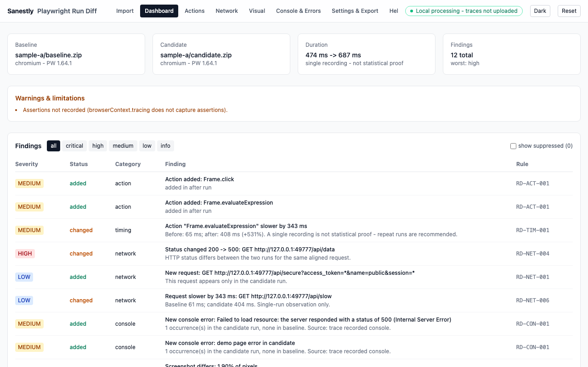
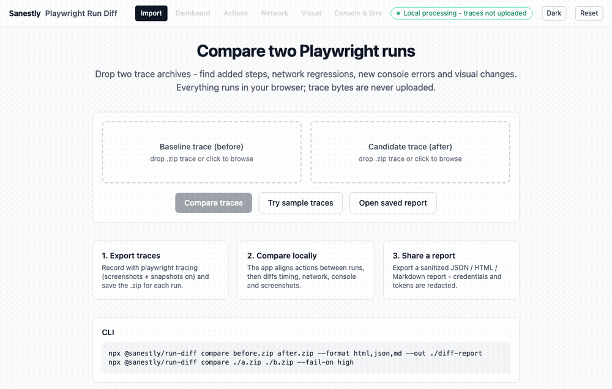

# Sanestly Playwright Run Diff

**Compare two Playwright test traces, locate behavioral regressions, and share a reproducible, privacy-aware diff report.**

Drop two `.zip` trace archives (baseline vs candidate) and get an aligned action-by-action diff: added/removed steps, timing regressions, new 5xx responses, new console errors, and pixel-level screenshot diffs - all computed locally in your browser or CI.

> Playwright Run Diff compares **two independent runs** and produces matched-action deltas - it is not a re-implementation of the official Trace Viewer, and is not affiliated with Playwright or Microsoft.



## Quick start

### Browser (no install, no login)

1. Open the app.
2. Click **Try sample traces** to inspect a real recorded comparison, or drop `before.zip` / `after.zip`.
3. Explore the dashboard, action alignment, network diffs, console changes and visual diffs.
4. Export a sanitized report as JSON / Markdown / self-contained HTML.



### CLI

```bash
# Once published: npx @sanestly/run-diff compare before.zip after.zip
# From source:
pnpm install && pnpm -r build

# Compare two archives, write all report formats
node apps/cli/dist/bin.js compare before.zip after.zip --format html,json,md --out ./diff-report

# Inspect a single archive
node apps/cli/dist/bin.js inspect ./trace.zip

# Fail the build when high-severity findings exist
node apps/cli/dist/bin.js compare ./a.zip ./b.zip --fail-on high --config run-diff.config.json

# Multi-run aggregate stats (>=2 archives per side, comma-separated)
node apps/cli/dist/bin.js compare a1.zip,a2.zip b1.zip,b2.zip --format md
```

Exit codes: `0` ok / below threshold, `1` findings at or above `--fail-on`, `2` invalid input/arguments, `3` internal failure.

## What it detects

| Category | Examples |
| --- | --- |
| Actions | added/removed/reordered steps, actions that now fail, manual re-pairing |
| Timing | per-action duration regressions past absolute + relative thresholds |
| Network | new/removed requests, status changes (200 -> 500), failures, latency deltas |
| Console | new errors/warnings/log-count changes |
| Visual | pixel diffs of paired screencast frames with configurable ratio + masks |

Every finding carries a versioned rule id (`RD-NET-004`, ...), severity, confidence, evidence references and investigation hints.

## Privacy

- **Local processing - traces are not uploaded.** Parsing, matching and pixel diffing run in a Web Worker (or Node for the CLI).
- Reports contain normalized metadata only: sanitized URLs, redacted secrets, no cookies, headers, request bodies or screenshot binaries.
- See [PRIVACY.md](PRIVACY.md) and [SECURITY.md](SECURITY.md).

## Recording compatible traces

```ts
const context = await browser.newContext();
await context.tracing.start({ screenshots: true, snapshots: true });
// ... run the same flow ...
await context.tracing.stop({ path: 'before.zip' });
```

Or with Playwright Test: `use: { trace: 'on' }` / `trace: 'retain-on-failure'`. Note `browserContext.tracing` does not capture assertions - those report as "not recorded"; test-runner traces do record them.

**Verified producers** (see [trace-compatibility](docs/trace-compatibility.md) for the full matrix): `context.tracing` on Playwright 1.60.0 and 1.64.1 across Chromium, Firefox and WebKit; `@playwright/test` traces on all three engines. Other versions fall back to a tolerant adapter and are labeled `partial` - never silently trusted.

## Limits

- 150 MiB compressed per archive (configurable to 300 MiB), 600 MiB decompressed aggregate, 25,000 entries, 20 MiB per JSONL line.
- Encrypted/split ZIPs, zip-slip paths and compression bombs are rejected.
- A single recording is **not** statistical proof of a regression - the report says so explicitly.

## Repository layout

```
apps/web          React + Vite SPA (browser explorer)
apps/cli          run-diff Node CLI
packages/contracts   normalized types + zod schema (report schemaVersion 1.0)
packages/trace-reader  ZIP security guard, probe, adapters, normalizer
packages/matcher       anchored action-sequence alignment
packages/analysis      finding rules (timing/network/console/visual)
packages/report        deterministic JSON/Markdown/HTML exporters
fixtures/generated     real traces (chromium/firefox/webkit, two Playwright versions,
                       context.tracing + @playwright/test producers) + generators
scripts/               fixture generators, benchmark, e2e, asset capture
docs/                  architecture, compatibility, schema, CLI docs, media assets
```

## Development

```bash
pnpm install
pnpm -r build          # build all packages
pnpm -r test           # unit + golden fixture tests
pnpm dev:web           # web app dev server
pnpm fixtures:generate # regenerate real trace fixtures (needs chromium)
```

## Documentation

- [Architecture](docs/architecture.md)
- [Trace compatibility matrix](docs/trace-compatibility.md)
- [Report JSON schema](docs/report-schema.md)
- [CLI reference](docs/cli.md)
- [Contributing](CONTRIBUTING.md) - [Changelog](CHANGELOG.md)

## License

MIT - see [LICENSE](LICENSE).
